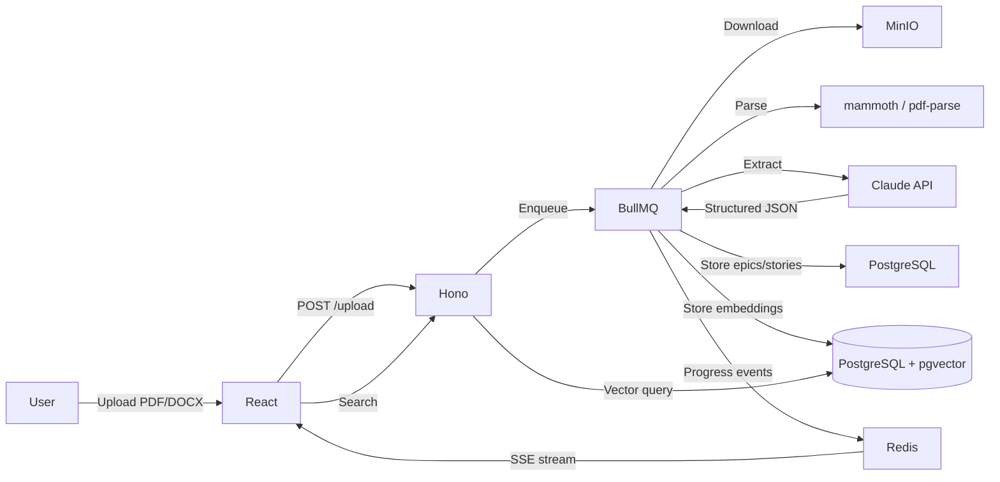

# 🛠️ SpecForge

> AI-powered requirements extraction platform. Upload a PDF/DOCX or describe your
> project conversationally — a Claude-powered pipeline extracts structured epics,
> user stories, and acceptance criteria, makes them semantically searchable with
> pgvector, and tracks the AI cost of every extraction.


---

## What it does

SpecForge turns messy product documents into structured requirements. A two-pass
Claude pipeline extracts epics, then user stories with Given/When/Then acceptance
criteria, validating every response against a Zod schema. Results are searchable
via pgvector semantic search and a token-economics dashboard reports the exact
cost and cache efficiency of every extraction.

---

## Architecture



---

## Tech stack

| Layer | Technology | Why |
|---|---|---|
| Frontend | React + TypeScript (Vite) | Fast DX, typed end-to-end |
| API | Hono on Node.js | Lightweight, native SSE streaming (ADR-004) |
| Database | PostgreSQL + pgvector | Vector search without a separate service (ADR-001) |
| Job queue | BullMQ + Redis | Async extraction with progress events (ADR-002) |
| AI | Anthropic Claude (tool use + streaming) | 200K context, reliable structured output (ADR-003) |
| Embeddings | OpenAI text-embedding-3-small | 1536-dim vectors for semantic search |
| Doc parsing | mammoth (DOCX) + pdf-parse (PDF) | Robust text extraction |
| Object storage | MinIO (S3-compatible) | Local-first, S3 API compatible |
| Deployment | Cloud Run + Firebase Hosting | Zero-ops, scales to zero (ADR-005) |

---

## Monorepo layout

```
specforge/
  apps/api/        Hono backend (db, storage, queue, ai, routes)
  apps/web/        React frontend (pages, components, lib)
  packages/shared/ Shared TypeScript types (zero runtime deps)
  docker-compose.yml  cloudbuild.yaml  firebase.json  Makefile
```

---

## Prerequisites

- Node 20+ and **pnpm** (`corepack enable`)
- PostgreSQL 16+ with the **pgvector** extension (or Docker — see below)
- Redis 6.2+
- MinIO (or any S3-compatible store)
- An **Anthropic API key** (required) and optionally an **OpenAI API key** (embeddings)

> The reference environment uses `docker-compose.yml` (Postgres+pgvector, Redis,
> MinIO). On a machine without Docker, run those three as native services and
> point `.env` at them.

---

## Getting started

```bash
git clone <repo-url> specforge && cd specforge
cp .env.example .env          # add your ANTHROPIC_API_KEY (and OPENAI_API_KEY)
corepack enable               # provides pnpm
pnpm install

# Start dependencies (with Docker):
docker compose up -d
# ...or run Postgres+pgvector, Redis, MinIO natively and update .env

pnpm --filter @specforge/shared build
make migrate                  # apply DB migrations
make seed                     # create the Acme demo org + 2 projects

# Run both apps:
pnpm --filter api dev         # http://localhost:3000
pnpm --filter web dev         # http://localhost:5173
```

Open http://localhost:5173.

To enable semantic search, set `OPENAI_API_KEY` and `EMBEDDINGS_ENABLED=true` in
`.env`, then re-run extractions so embeddings are generated.

---

## Local development — start & stop

This project runs its infrastructure as **native services on Windows (no Docker)**:
PostgreSQL 18 + pgvector as a Windows service, and MinIO + Redis as standalone
binaries in `.tools/`. Two scripts wrap the whole lifecycle.

### Start everything

```powershell
./scripts/dev-up.ps1
```

Idempotently (skipping anything already up):
1. Starts the `postgresql-x64-18` Windows service if stopped.
2. Starts **MinIO** (`.tools/minio.exe`) → API `:9000`, console `:9001`.
3. Starts **Redis** (`.tools/redis/.../redis-server.exe`) → `:6379`.
4. Launches the **API** (`:3000`) and **web** (`:5173`) dev servers, each in its
   own window so you can watch logs.

Then open **http://localhost:5173** and check **http://localhost:3000/health**.

### Stop everything

```powershell
./scripts/dev-down.ps1                # stops API, web, MinIO, Redis
./scripts/dev-down.ps1 -StopPostgres  # also stops the Postgres service
```

(Postgres is left running by default since it's shared infrastructure.)

### Service reference

| Service | Port(s) | How it runs | Health check |
|---|---|---|---|
| PostgreSQL + pgvector | 5432 | Windows service `postgresql-x64-18` | `Get-Service postgresql-x64-18` |
| Redis | 6379 | `.tools/redis/.../redis-server.exe` | `redis-cli ping` → `PONG` |
| MinIO | 9000 / 9001 | `.tools/minio.exe` | `curl localhost:9000/minio/health/live` |
| API (Hono) | 3000 | `pnpm --filter api dev` | `curl localhost:3000/health` |
| Web (Vite) | 5173 | `pnpm --filter web dev` | open in browser |

### Manual control (without the scripts)

```powershell
# Infra
Start-Service postgresql-x64-18
$env:MINIO_ROOT_USER='minioadmin'; $env:MINIO_ROOT_PASSWORD='minioadmin'
.\.tools\minio.exe server .\.data\minio --console-address ":9001"
.\.tools\redis\Redis-8.8.0-Windows-x64-msys2\redis-server.exe --port 6379 --save "" --appendonly no

# Apps
pnpm --filter api dev      # http://localhost:3000
pnpm --filter web dev      # http://localhost:5173

# Stop a single server (kill the port owner)
Get-NetTCPConnection -LocalPort 3000 -State Listen | %{ Stop-Process -Id $_.OwningProcess -Force }
```

> On a machine **with Docker**, use `docker compose up -d` / `docker compose down`
> (see `docker-compose.yml`) instead of the native binaries.

### Smoke tests

```powershell
pnpm --filter api exec tsx src/scripts/smoke-storage.ts   # MinIO round-trip
pnpm --filter api exec tsx src/scripts/smoke-queue.ts     # BullMQ + pub/sub
pnpm --filter api exec tsx src/scripts/smoke-extract.ts   # live Claude extraction (needs key)
```

### Theme

The web app ships a **light theme (default) and a dark theme**, toggled from the
top bar (sun/moon). The preference persists in `localStorage`.

---

## How the extraction pipeline works

1. **Upload** → file stored in MinIO, a `documents` row + queued `extraction_jobs`
   row created, BullMQ job enqueued (202 Accepted with a `jobId`).
2. **Worker** (concurrency 2 — bounded by Claude rate limits): downloads, parses
   (mammoth/pdf-parse), cleans + truncates to 150k chars.
3. **Pass 1** — `extract_epics` tool call over the whole document.
4. **Pass 2** — `extract_stories` tool call per epic. Two passes because accuracy
   degrades on deeply nested schemas in a single call (ADR-003).
5. Every Claude response is **validated with Zod** and **retried once** with the
   validation errors appended on failure.
6. Optional **embeddings** for each epic (feature-flagged).
7. Results persisted; job updated with token counts + USD cost; progress streamed
   to the browser over **SSE** the whole way.

Every Claude call logs `model`, `promptVersion`, `inputTokens`, `outputTokens`,
`cacheReadTokens`, `latencyMs`, and `costUsd` as structured JSON.

---

## API reference

| Method | Endpoint | Description |
|---|---|---|
| GET | `/health` | Per-dependency health (postgres, redis, minio) |
| GET | `/api/org/default` | The seeded demo org |
| GET | `/api/projects?orgId=` | List projects |
| POST | `/api/projects` | Create a project |
| GET | `/api/projects/:id` | Project with epics + stories |
| GET | `/api/projects/:id/search?q=` | Semantic search (org+project scoped) |
| POST | `/api/documents/upload` | Upload PDF/DOCX (multipart) → 202 + jobId |
| GET | `/api/jobs/:jobId` | Job status (polling fallback) |
| GET | `/api/jobs/:jobId/progress` | SSE progress stream |
| GET | `/api/epics/:id` | Epic with stories |
| PATCH | `/api/epics/:id` | Update title/description/priority |
| DELETE | `/api/epics/:id` | Soft delete |
| POST | `/api/chat/stream` | Streamed requirements chat (SSE) |
| GET | `/api/analytics/overview?orgId=` | Headline KPIs + cache hit rate |
| GET | `/api/analytics/timeline?orgId=&days=` | Daily cost/usage |
| GET | `/api/analytics/by_model?orgId=` | Per-model usage |
| GET | `/api/analytics/jobs?orgId=` | Recent extraction jobs |
| POST | `/api/analytics/cost-estimate` | Three-tier monthly cost estimate |

All responses are camelCase JSON; errors use `{ error, code, details? }`.

---

## Deployment

Production targets **Cloud Run** (API) and **Firebase Hosting** (web) — see
`cloudbuild.yaml` and `firebase.json`. Cloud Run is preferred over a hand-managed
nginx + PM2 VM: it gives HTTPS, load balancing, and autoscaling (to zero when
idle) for the price of handing GCP a container. See **ADR-005** for the full
rationale. Secrets come from Secret Manager — never the image or build config.

```bash
make deploy-api   # gcloud builds submit --config cloudbuild.yaml
make deploy-web   # firebase deploy --only hosting
```

---

## Contributing — Definition of Done

A pull request is ready to merge when:

**Code**
- [ ] All existing tests pass (`pnpm test`)
- [ ] New behaviour has test coverage
- [ ] Zero TypeScript errors (`pnpm -r typecheck`)
- [ ] No `any` types introduced
- [ ] Lint passes with zero warnings

**Observability**
- [ ] New operations emit structured JSON logs with an event name + context
- [ ] New Claude API calls log model, tokens, latency, cost
- [ ] New failure modes have typed error classes

**Documentation**
- [ ] JSDoc on all new exported functions
- [ ] ADR written for any significant architectural decision
- [ ] `RUNBOOK.md` updated if operational procedures changed
- [ ] `CHANGELOG.md` entry added

**Production readiness**
- [ ] No hardcoded secrets or environment-specific values
- [ ] Pinned dependency versions (no `^`/`~` on core deps)
- [ ] Feature-flagged if the behaviour might need to be disabled quickly
- [ ] PR description explains the *why*, not just the *what*

---

## Roadmap

- Multi-tenant auth (Clerk or Supabase Auth) replacing the demo org context
- Intelligent model routing (Haiku for classification, Sonnet for extraction)
- Export to Jira / Linear / Notion
- Evals in CI gating model-version upgrades (see `POST_MORTEM_TEMPLATE.md`)

---

## Documentation

- [`DECISIONS.md`](DECISIONS.md) — 5 ADRs covering every major stack choice
- [`RUNBOOK.md`](RUNBOOK.md) — operations: health checks, alerts, common ops
- [`POST_MORTEM_TEMPLATE.md`](POST_MORTEM_TEMPLATE.md) — example incident analysis
- [`docs/progress.md`](docs/progress.md) — build progress tracker
