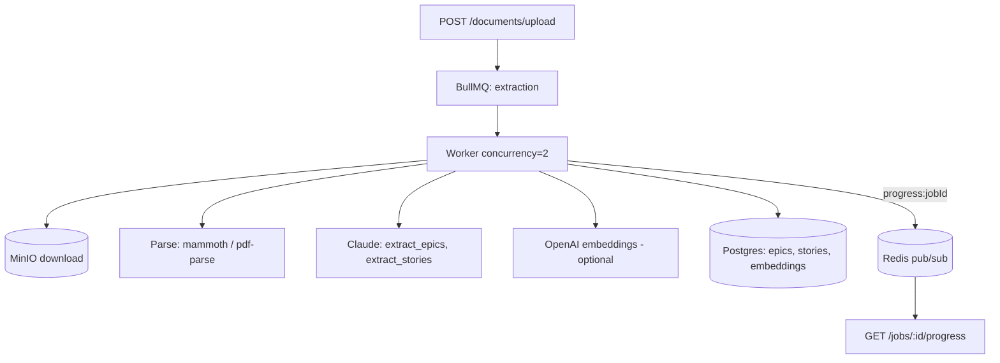

# SpecForge Runbook

Operational guide for the extraction pipeline. Written for the on-call engineer
who did not build it.

---

## Overview

SpecForge extracts structured requirements from documents using a Claude pipeline
behind a BullMQ queue. **Healthy** looks like:

- `GET /health` returns `200` with `postgres`, `redis`, `minio` all `true`.
- Extraction latency p50 ~15–40s, p99 < 120s for typical documents.
- Cost per document roughly **$0.01–$0.10** (Sonnet, depends on length).
- Cache hit rate **> 60%** once warm (system prompt reused across pass-2 calls).
- BullMQ queue depth near zero; no jobs stuck in `processing`.

---

## Architecture



---

## Health checks

| Component | How to check | Healthy signal |
|---|---|---|
| API | `curl localhost:3000/health` | `status: ok`, all services true |
| PostgreSQL | `SELECT 1`; `SELECT * FROM pg_stat_activity WHERE state='active'` | responds; no long-running queries |
| pgvector | `SELECT extversion FROM pg_extension WHERE extname='vector'` | returns a version |
| Redis | `redis-cli PING`; `redis-cli INFO memory` | `PONG`; memory not near maxmemory |
| MinIO | `curl localhost:9000/minio/health/live` | `200` |
| BullMQ | inspect queue counts (active/waiting/failed) | waiting≈0, failed low |
| Cloud Run | GCP console → request count + error rate | error rate < 1% |

---

## Common operations

**Deploy a new API version**
```bash
make deploy-api        # gcloud builds submit --config cloudbuild.yaml
```

**Roll back to the previous Cloud Run revision**
```bash
gcloud run revisions list --service specforge-api --region me-central2
gcloud run services update-traffic specforge-api --region me-central2 \
  --to-revisions <PREVIOUS_REVISION>=100
```

**Run database migrations in production**
Migrations run automatically on API startup (`runMigrations()` in `index.ts`).
To run manually: `pnpm --filter api db:migrate` against the prod `DATABASE_URL`.

**Manually retry a failed extraction job**
1. Find it: `SELECT id, document_id, error FROM extraction_jobs WHERE status='failed' ORDER BY created_at DESC;`
2. Re-enqueue the document via `addExtractionJob` (or re-upload). The job uses a
   fresh UUID; the old failed row remains for audit.

**Clear a stuck BullMQ queue**
```bash
# Inspect, then drain if needed (development):
redis-cli KEYS "bull:extraction:*"
# Last resort (data loss for queued jobs):
redis-cli DEL <keys>
```
Prefer pausing the worker and letting in-flight jobs finish over flushing.

**Rotate the Anthropic API key**
1. Add the new key as a new Secret Manager version (`anthropic-api-key`).
2. Redeploy (`make deploy-api`) so Cloud Run picks up `:latest`.
3. Revoke the old key in the Anthropic console once traffic is confirmed healthy.

---

## Alert responses

### Alert 1 — extraction_failure_rate > 10% over 5 min
**Meaning:** a significant share of jobs are failing.
**Likely causes (most→least common):** Claude API outage/429s; schema validation
failures after a prompt change; Redis or DB connectivity.
**Steps:**
1. Check https://status.anthropic.com.
2. `SELECT error, COUNT(*) FROM extraction_jobs WHERE status='failed' AND created_at > now()-interval '15 min' GROUP BY error;`
3. If validation errors dominate, check for a recent prompt/model change → roll back.
4. Verify Redis (`PING`) and DB (`SELECT 1`).

### Alert 2 — queue_depth > 50
**Meaning:** jobs are piling up faster than they drain.
**Likely causes:** worker crashed; throughput spike; Claude slowdown.
**Steps:**
1. Confirm the worker is alive (look for `worker_started` log; check active count).
2. Check worker logs for repeated `worker_error`.
3. Check Cloud Run instance count; ensure the worker process is running.
4. If Claude is slow, depth will drain on its own — do **not** raise concurrency
   above 2 without testing (429 risk).

### Alert 3 — avg_cost_per_document > 2× baseline
**Meaning:** extractions are suddenly more expensive.
**Likely causes:** prompt-caching miss (system prompt changed → cache invalidated);
unusually long documents; a model change.
**Steps:**
1. `SELECT cache_read_tokens, prompt_tokens FROM extraction_jobs ORDER BY created_at DESC LIMIT 20;`
   — a low `cache_read/prompt` ratio means caching broke.
2. Check whether the system prompt or model version changed recently.
3. Check recent document sizes.

### Alert 4 — p99 extraction latency > 120s
**Likely causes:** Claude slowdown; very large documents; embedding batch backup.
**Steps:**
1. Check Anthropic status.
2. Check `size_bytes` distribution of recent documents.
3. Check `embeddings_batch` log latencies separately; disable embeddings via
   `EMBEDDINGS_ENABLED=false` if they are the bottleneck.

---

## Escalation

If an incident is customer-facing and not resolved within 30 minutes, escalate to
the service owner. Include: the alert that fired, affected `jobId`s, the dominant
`error` value, recent deploy/revision, and links to the relevant logs. For an AI
quality regression (no errors, worse output), see `POST_MORTEM_TEMPLATE.md`.
